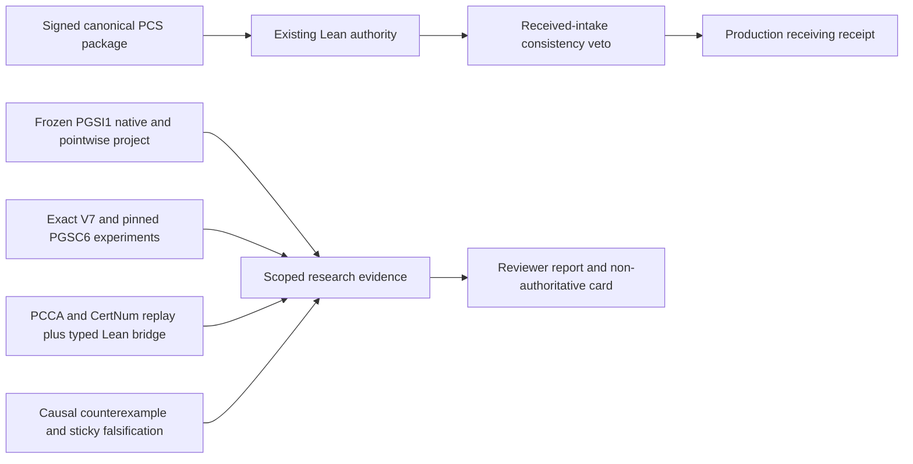

# Consolidated PCS research integration

Status: draft integration under qualification. This report does not assert final hosted CI or release approval. The dedicated branch is `integration/pcs-all-open-prs-synthesis-20261018-sol-high`, based on main `fabc704efdbda4c8822881366e4db3d3e31f066a`. No source PR, main branch, deployment, or release has been merged or modified by this work.

All 32 frozen PRs have explicit dispositions in PR_CAPABILITY_COVERAGE.json. Accessible source capabilities are imported; V8 implementation remains BLOCKED_EXTERNAL_INPUT. Original-head observations and integrated observations carry separate exact commits in evidence/. Historical reports retain their original source identities.

The integration provides a new executable research demonstration combining exact rational conservation replay, numerical interval replay, a finite causal non-identifiability witness, and sticky falsification that reopens dependencies across separate engines. These are computational observations with distinct scopes. Empirical validity and Python-to-Lean refinement remain OPEN. Reviewer reports and Assurance Cards remain inspection tools; real v0.6 package receiving stays a separate Lean-authoritative lane.

Exact V7 sources coexist with a repo-shaped frozen PGSI1 project. The latter preserves the 19/35/41-file identities and its full research history. ESCA141 and EOL146 retain separate Lean projects and semantics. PGSC6 references copied identically across historical stacks are deduplicated by byte identity, while genuinely independent algorithms remain independent.

Repairs include incomplete numerical coverage and absent incumbent rejection; actual-base branch auditing and inconclusive missing refs; explicit optional-component pinning; causal rule-two outgoing-edge semantics; and kernel `decide` proofs replacing native compiler controls. None changes the original mathematical propositions. The production host change from120 is an explicitly justified received-intake veto, never broader Lean acceptance.

Verification status, including infrastructure retries and scientific negatives, is detailed in REGRESSION_COMPARISON.md and the machine-readable evidence. This is not production self-modification functionality or an empirical scientific breakthrough.

Draft PR: https://github.com/Tommaso-R-Marena/proof-carrying-science/pull/153. No source branch or main was modified. A subsequent head recheck found all32 original heads unchanged;153 is the only additional open PR. The source identity gate now pins1992 files, including the exact main build configuration and all isolated research configurations. The five-theorem conservation/enclosure bridge, fixed Python–Lean fixture,22 native-intake tests and15 cross-PR tests pass; final full production and hosted checks remain separately tracked rather than inferred from those successes.

## Completed local qualification

The complete prescribed core gate now passes:1,992 Python tests, zero failures/skips, both25-case foundational and12-case v0.6 adversarial campaigns rejected every attack, actual standard Lean builds/audits passed, and the Mathlib real-analysis bridge plus its3 statistics checks passed. All15 cross-PR tests,22 native-intake tests including a fresh cleanroom, and five new authored bridge theorems pass. The two deliberate false claims are rejected by actual Lean. The exact source profile and executed commands are in evidence/LOCAL_QUALIFICATION.json and retained logs. Earlier failures remain preserved and are not counted as final successes.

All32 source PR heads were rechecked unchanged. V8 remains incomplete. Hosted verification must be assessed on the final PR head/merge SHA through https://github.com/Tommaso-R-Marena/proof-carrying-science/pull/153/checks; this snapshot does not fabricate a future CI conclusion. The PR remains draft for independent review, with no main merge or deployment.

There is no research-to-production activation edge. Formal truth, host correspondence, scientific assumptions and empirical validity retain separate statuses.
